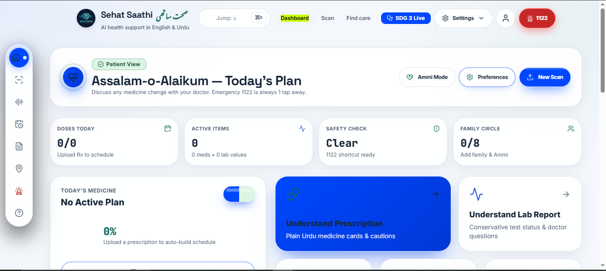
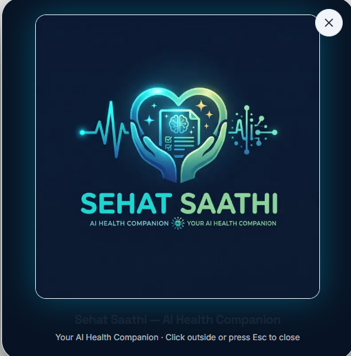
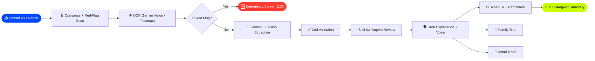
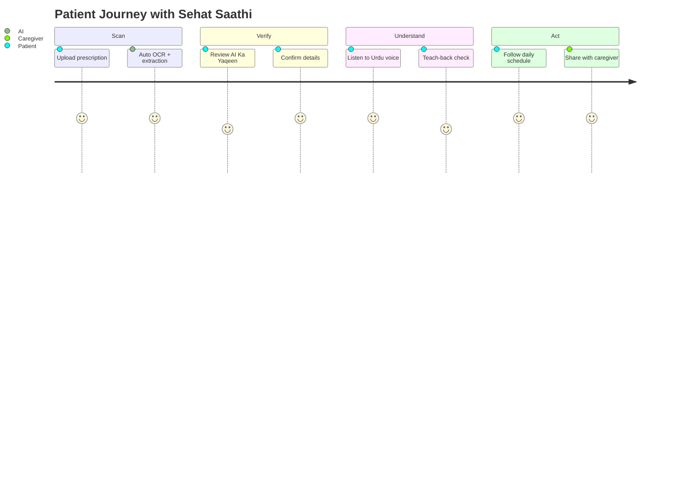
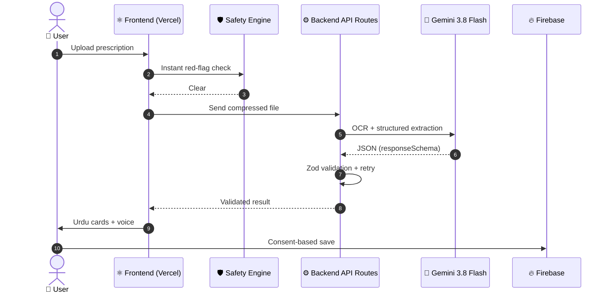
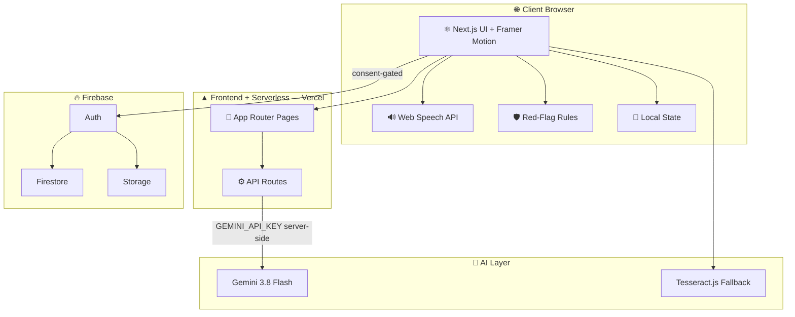
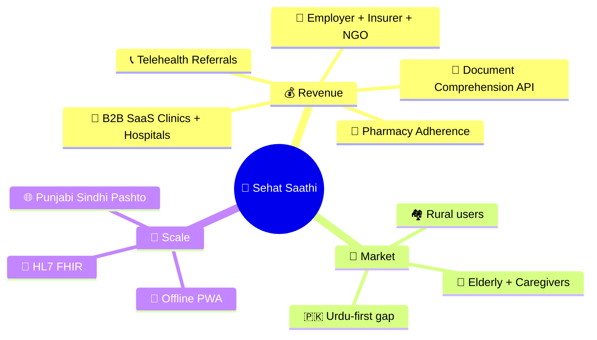

<div align="center">

<a href="https://duo-ai-hackathon.vercel.app/">

</a>

<br/>

<a href="https://duo-ai-hackathon.vercel.app/">

</a>

<br/><br/>

<a href="https://duo-ai-hackathon.vercel.app/">

</a>

<br/><br/>


&nbsp;

&nbsp;


<br/><br/>


&nbsp;

&nbsp;

&nbsp;


<br/><br/>


&nbsp;

&nbsp;

&nbsp;


<br/><br/>


&nbsp;

&nbsp;


</div>

---


## 📑 Quick Navigation

| | | | |
|--|--|--|--|
| [🩺 Problem](#-the-problem) | [🖼 Screenshots](#-screenshots) | [✨ Features](#-features) | [🔄 Workflow](#-end-to-end-workflow) |
| [🤖 AI Pipeline](#-ai-pipeline) | [🏗 Architecture](#-system-architecture) | [🛠 Tech Stack](#-tech-stack) | [🌳 Project Tree](#-project-tree) |
| [🛡 Safety](#-safety--privacy) | [⚡ Setup](#-local-setup) | [💼 Startup](#-startup--business-model) | [🏆 Judging](#-judging-criteria-map) |

---

## 🩺 The Problem

<div align="center">

| 💊 Medication Errors | 🧪 Unclear Lab Results | 🚨 Delayed Emergency Care |
|:---:|:---:|:---:|
| Wrong timing, missed doses | Normal vs needs attention? | Warning signs ignored |
| English + clinical jargon | Dense formatting | Unsafe informal advice |

</div>

### 🎯 One Barrier. One Solution.

| ❌ Before | ✅ With Sehat Saathi |
|---|---|
| English prescriptions | 🗣 Urdu / Roman Urdu cards |
| Hard-to-read labels | 🔊 Voice playback |
| Forgotten doses | ⏰ Visual schedule + reminders |
| Unknown red flags | 🚨 Instant 1122 escalation |
| Confused caregivers | 👨‍👩‍👧 Shared family timeline |

---

## 👥 Target Users

| 👤 User | 🎯 Need | 💡 Sehat Saathi Helps With |
|---|---|---|
| 🧑 **Patients** | Understand Rx and labs | Urdu cards + voice readout |
| 👨‍👩‍👧 **Caregivers** | Manage parents' / kids' medicines | Shared schedule + alerts |
| 👵 **Elderly** | Low-text, audio-friendly UI | Large text, high contrast, voice |
| 🏘 **Rural / First-Time Users** | Simple visual actions | Icon-led Urdu navigation |
| 🏥 **Clinics & Pharmacies** | Better adherence | White-label comprehension portal |

---


## 🖼 Screenshots

<div align="center">

### 🏠 Dashboard — Today's Plan



<br/>

| 💊 Doses Today | 🩺 Active Items | 🛡 Safety Check | 👨‍👩‍👧 Family Circle |
|:---:|:---:|:---:|:---:|
| Live dose tracker | Meds + lab values | 1122 shortcut ready | Up to 8 members |

<br/>

### 🎨 Brand



</div>

---

## ✨ Features

### 📄 Understand

| | Feature | Detail |
|--|---|---|
| 📤 | **Upload + OCR** | JPG · PNG · WebP · PDF · typed text |
| 👁 | **Gemini Vision OCR** | Tesseract.js fallback |
| 🧾 | **Structured Extraction** | Medicines, doses, frequency, duration, food rules, lab values |
| ✅ | **Strict Validation** | JSON Schema + Zod + 1 retry |
| ✋ | **User Confirmation** | Low-confidence fields must be confirmed |
| 🌐 | **3 Languages** | Urdu · Roman Urdu · English |
| 🚦 | **Lab Status** | `Normal` · `Needs Attention` · `Discuss with Doctor` · `Unknown` |

### 🔊 Accessible

| | Feature | Detail |
|--|---|---|
| 🗣 | **Voice Playback** | Play · pause · replay · speed |
| 🔠 | **Large Text** | `A+` mode |
| 🌗 | **High Contrast** | Elderly-friendly |
| ⌨️ | **Keyboard + Touch** | Large tap targets |
| 👵 | **Ammi Mode** | Giant fonts + 🌅 ☀️ 🌙 🍽 pictograms |

### 🛡 Safe

| | Feature | Detail |
|--|---|---|
| 🚨 | **Emergency Engine** | Rule-based, runs before AI |
| ⚡ | **Instant Access** | `Shift+E` or `1122` from any screen |
| 🩸 | **Red Flags** | Chest pain · breathing · fainting · allergy · bleeding · self-harm · stroke signs |
| 📌 | **Disclaimer** | On every explanation and safety screen |

### 👨‍👩‍👧 Manage

| | Feature | Detail |
|--|---|---|
| ⏰ | **Daily Schedule** | Morning · Afternoon · Night · As Needed |
| ☑️ | **Dose Tracking** | Checkboxes + missed-dose guidance |
| 🌳 | **Mera Khandaan** | 3 generations · 8 members |
| 📅 | **Family Timeline** | "Aaj poore khandaan ki dawaein" |
| 💬 | **WhatsApp Summary** | Live Gemini |
| 🖨 | **Print / Export** | JSON export + print chart |
| 🗺 | **Lahore Care Navigator** | Clinics · hospitals · pharmacies |

### 🧪 Verify

| | Feature | Detail |
|--|---|---|
| 🔍 | **AI Ka Yaqeen** | Side-by-side review, amber highlights |
| 🧠 | **Samajh Gaye?** | Teach-back comprehension check |
| 💬 | **Dawa Se Poochho** | Medicine Q&A |
| 📦 | **Dawa-Match** | Strip comparison |
| 📊 | **Live Scorecard** | Accuracy across 5 synthetic Rx |
| ⚖️ | **Judge Challenge** | Live safety test |

---


## 🔄 End-to-End Workflow



### 🧭 User Journey



### ⏱ Request Sequence



---

## 🤖 AI Pipeline

```
╔════════════════════════════════════════════════════════════════════╗
║                     SEHAT SAATHI AI PIPELINE                       ║
╠════════════════════════════════════════════════════════════════════╣
║                                                                    ║
║   📥 INPUT  Prescription / Lab Report (image · PDF · text)         ║
║      │                                                             ║
║      ▼   🗜 client resize + compression + instant red-flag scan    ║
║   ┌───────────────────────────────────────┐                        ║
║   │  👁 OCR EXTRACTION                    │                        ║
║   │  ├─ Primary : Gemini Vision           │                        ║
║   │  └─ Fallback: Tesseract.js            │                        ║
║   └───────────────────────────────────────┘                        ║
║      │                                                             ║
║      ▼                                                             ║
║   ┌───────────────────────────────────────┐   🚨 RED FLAG          ║
║   │  🛡 RULE-BASED SAFETY ENGINE          │ ─────────► /emergency  ║
║   └───────────────────────────────────────┘   bypasses AI          ║
║      │ clear                                                       ║
║      ▼                                                             ║
║   ┌───────────────────────────────────────┐                        ║
║   │  🧠 GEMINI 3.8 FLASH EXTRACTION       │                        ║
║   │  strict responseSchema (JSON)         │                        ║
║   │  + Zod validation, retry once         │                        ║
║   └───────────────────────────────────────┘                        ║
║      │                                                             ║
║      ▼                                                             ║
║   📤 OUTPUT  Urdu · Roman Urdu · English UI                        ║
║                                                                    ║
╚════════════════════════════════════════════════════════════════════╝
```

### 🧠 Why It's More Than an API Wrapper

| 🧩 Layer | ⚙️ Decision | 🎁 Benefit |
|---|---|---|
| 🛡 Safety | Rules run **before** the LLM | Emergencies never wait on a model |
| 📐 Output | `responseSchema` + Zod + retry | Reliable, typed, validated |
| 🔁 OCR | Gemini Vision → Tesseract fallback | Keeps working if primary fails |
| ✋ Trust | Confirm low-confidence fields | No silent hallucinations |
| 📊 Eval | Live scorecard on synthetic Rx | Measurable accuracy |
| 🔒 Privacy | In-memory processing | No patient data left on server |

---

## 🏗 System Architecture



<div align="center">

| 🌐 Layer | 🧰 Service | 🔑 Role |
|:---:|:---:|:---:|
| **Frontend** | ▲ Vercel | Hosting + serverless routes |
| **Backend** | 🧠 Gemini API (`gemini-3.8-flash`) | OCR, extraction, Q&A, summaries |
| **Database** | 🔥 Firebase | Auth · Firestore · Storage |

</div>

---


## 🛠 Tech Stack

<div align="center">

| | Layer | Technology |
|:--:|---|---|
| ▲ | **Frontend Hosting** | Vercel |
| ⚛️ | **Framework** | Next.js App Router + TypeScript (strict) |
| 🎨 | **Styling** | Tailwind CSS |
| 🎞 | **Motion** | Framer Motion (reduced-motion aware) |
| 🧠 | **AI Backend** | Gemini API · `gemini-3.8-flash` via `@google/genai` |
| ✅ | **Validation** | Zod |
| 👁 | **OCR** | Gemini Vision + `tesseract.js` |
| 🔊 | **Voice** | Web Speech API |
| 🔥 | **Database** | Firebase Auth · Firestore · Storage |
| 🔣 | **Icons** | `lucide-react` |

</div>

### 🎨 Design Palette

<div align="center">


</div>

---

## 🌳 Project Tree

```
📦 sehat-saathi
├── 📁 app
│   ├── 🏠 page.tsx                 → Landing + command bar
│   ├── 📊 dashboard/               → Today's plan
│   ├── 📤 upload/                  → Upload + OCR scan
│   ├── 🔍 review/                  → AI Ka Yaqeen review
│   ├── 🗣 explain/                 → Urdu cards, teach-back, Q&A, strip match
│   ├── 👵 ammi/                    → Zero-literacy mode
│   ├── ⏰ schedule/                → Daily schedule + reminders
│   ├── 🌳 family/                  → Mera Khandaan
│   ├── 🗺 care/                    → Lahore care navigation
│   ├── 👨‍👩‍👧 caregiver/              → Consent-based summary
│   ├── 📈 eval/                    → Live accuracy scorecard
│   ├── 🚨 emergency/               → Instant escalation
│   └── 📁 api
│       ├── 💬 family-summary/
│       ├── 🧠 teach-back/
│       ├── 💊 ask-medicine/
│       ├── 📦 medicine-match/
│       ├── 📊 eval/
│       └── ⚖️ safety-challenge/
├── 📁 lib
│   ├── 📁 ai
│   │   ├── 👁 ocr.ts               → Gemini Vision + Tesseract
│   │   ├── 🧠 gemini.ts            → Gemini client
│   │   ├── 📝 prompts.ts           → Prompt templates
│   │   └── 📐 schemas.ts           → Zod + JSON schemas
│   ├── 📁 safety
│   │   └── 🚨 redFlags.ts          → Deterministic emergency rules
│   └── 📁 utils
│       └── ✅ validate.ts          → Runtime validation
├── 📁 components                   → UI, pictograms, TickCross
├── 📁 scripts
│   └── 🌱 seed-demo.mjs            → Firebase emulator seed
├── 🔥 firestore.rules              → Consent-gated rules
├── 🔥 storage.rules
├── 🔑 .env.example
├── 📦 package.json
└── 📘 README.md
```

---

## 🛡 Safety & Privacy

| | Guard | Detail |
|--|---|---|
| 🚫 | **Non-diagnostic** | No diagnosis, prescribing or treatment changes |
| 📌 | **Persistent disclaimer** | Shown on every explanation and safety screen |
| 📎 | **Source-bound** | No fabricated medical facts |
| ✋ | **Confirm first** | Unclear fields need explicit confirmation |
| 🚨 | **Emergency override** | Red flags bypass AI generation |
| 🔒 | **Privacy by default** | Files processed in memory, never written to disk or Git |
| 🔥 | **Firebase rules** | Consent-gated Firestore + Storage |
| 🗑 | **One-tap delete** | Local data cleared instantly |
| 🧪 | **Synthetic data only** | No real patient records |

> ⚕️ *"Yeh medical diagnosis nahi hai; emergency ya serious symptoms mein foran qualified healthcare professional se rabta karein."*

---

## ⚡ Local Setup

```bash
git clone https://github.com/<your-username>/<your-repo>.git
cd <your-repo>
npm install
cp .env.example .env.local
npm run dev
```

🌐 Open **http://localhost:3000**

| ✅ Check | Command |
|---|---|
| 🧹 Lint | `npm run lint` |
| 🔎 Types | `npx tsc --noEmit` |
| 🏗 Build | `npm run build` |
| 🚀 Start | `npm run start` |

### 🔑 Environment Variables

| Variable | Required | Purpose |
|---|:---:|---|
| `GEMINI_API_KEY` | ✅ | Server-side Gemini key, never sent to browser |
| `GEMINI_MODEL` | ➖ | Defaults to `gemini-3.8-flash` |
| `NEXT_PUBLIC_FIREBASE_API_KEY` | ➖ | Firebase Web API key |
| `NEXT_PUBLIC_FIREBASE_AUTH_DOMAIN` | ➖ | Auth domain |
| `NEXT_PUBLIC_FIREBASE_PROJECT_ID` | ➖ | Project ID |
| `NEXT_PUBLIC_FIREBASE_STORAGE_BUCKET` | ➖ | Storage bucket |
| `NEXT_PUBLIC_FIREBASE_MESSAGING_SENDER_ID` | ➖ | Messaging sender ID |
| `NEXT_PUBLIC_FIREBASE_APP_ID` | ➖ | Web App ID |

---

## 🎬 3-Minute Demo

| ⏱ Time | 🎯 Step | 🔗 Route | ✨ Highlight |
|---|---|---|---|
| `0:00` | 🏠 Landing | `/` | Language switch + `⌘/Ctrl + K` |
| `0:40` | 📤 Upload & Scan | `/upload?demo=rx-1` | OCR + red-flag + Zod extraction |
| `1:20` | 🔍 Review | `/review` | AI Ka Yaqeen amber highlights |
| `1:45` | 🗣 Explain | `/explain` `/ammi` | Voice + pictograms + teach-back |
| `2:15` | ⏰ Schedule + 🌳 Family | `/schedule` `/family` | Tick doses + family timeline |
| `2:45` | 🚨 Emergency | `/emergency` | `Shift+E` → instant 1122 |

---


## 💼 Startup & Business Model



| 💰 Stream | 👥 Customer | 🎁 Value |
|---|---|---|
| 🏥 White-label SaaS | Clinics, hospitals | Better discharge comprehension |
| 💊 Adherence partnerships | Pharmacies | Refills + counseling |
| 📞 Referrals | Telehealth platforms | Care-navigation handoffs |
| 🤝 Sponsored access | Employers, insurers, NGOs | Community health literacy |
| 🔌 API | Digital-health apps | Usage-based extraction |

---

## 🏆 Judging Criteria Map

| 🎯 Criterion | ⚖️ Weight | ✅ Our Delivery |
|---|:---:|---|
| **Problem Fit & Startup** | 25% | SDG 3 health-literacy gap · defined users · 5 revenue streams |
| **Working Prototype** | 25% | Full journey upload → schedule → emergency · live on Vercel |
| **AI Depth** | 20% | Gemini multimodal + schema + Zod + OCR fallback + safety engine + live eval |
| **Design & Originality** | 15% | Urdu-first · voice-first · Ammi Mode · pictograms · family tree |
| **Live Demo & Q&A** | 15% | 3-minute script · one-key emergency · judge safety challenge |

---

## 🗺 Roadmap

| ✅ | Milestone |
|:--:|---|
| 🔲 | 🌐 Punjabi · Sindhi · Pashto · Balochi · Saraiki + neural Urdu voice |
| 🔲 | ✍️ Handwriting-specialized pharmacy verification |
| 🔲 | 📈 Longitudinal adherence trends + encrypted caregiver sync |
| 🔲 | 📶 Offline-friendly PWA |
| 🔲 | 🔗 National registries + HL7 / FHIR lab exports |

---

## 🔎 Keywords

`SDG 3` · `Good Health and Well-Being` · `AI healthcare Pakistan` · `Urdu AI` · `Roman Urdu` · `prescription reader` · `lab report explainer` · `medication adherence` · `health literacy` · `Gemini 3.8 Flash` · `Next.js` · `Firebase` · `Vercel` · `accessible health app` · `voice health assistant` · `emergency red-flag detection` · `caregiver app` · `digital health startup`

---

## 👨‍💻 Team

🏫 **Minhaj University Lahore** · 🏆 **STCS AI Hackathon & Startup Pitch 2026** · 👤 **Abdullah Javid** and team

<div align="center">

<a href="https://github.com/mabdullahab614-alt"></a>
&nbsp;
<a href="mailto:mabdullah.ab614@gmail.com"></a>
&nbsp;
<a href="https://www.linkedin.com/in/abdullah-javid-b217a2384/"></a>

<br/><br/>

<a href="https://duo-ai-hackathon.vercel.app/">

</a>

<br/>

⚕️ *Sehat Saathi is an educational tool, not a medical diagnostic device. Always consult a qualified healthcare professional.*


</div>
