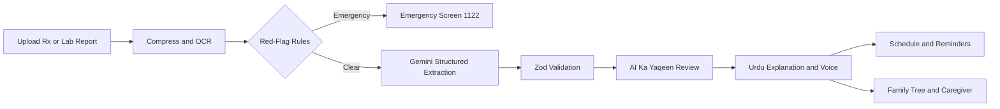

<div align="center">

<a href="https://duo-ai-hackathon.vercel.app/">

</a>

<a href="https://duo-ai-hackathon.vercel.app/">

</a>

<br/><br/>

<a href="https://duo-ai-hackathon.vercel.app/">

</a>

<br/><br/>


&nbsp;

&nbsp;


<br/><br/>


&nbsp;

&nbsp;

&nbsp;

&nbsp;


<br/><br/>


&nbsp;

&nbsp;


</div>

---


## 📑 Table of Contents

| | | |
|--|--|--|
| [🩺 The Problem](#-the-problem) | [✨ Features](#-features) | [🖼 Screenshots](#-screenshots) |
| [👥 Target Users](#-target-users) | [🤖 AI Architecture](#-ai-architecture) | [🛡 Safety & Privacy](#-safety--privacy) |
| [🛠 Tech Stack](#-tech-stack) | [⚡ Local Setup](#-local-setup) | [🎬 3-Minute Demo](#-3-minute-demo-walkthrough) |
| [💼 Startup Model](#-startup--business-model) | [🏆 Judging Criteria](#-how-we-map-to-the-judging-criteria) | [🗺 Roadmap](#-roadmap) |

---


## 🩺 The Problem

Millions of patients in Pakistan and across South Asia receive **prescriptions, lab reports and discharge instructions in English, clinical jargon or dense handwriting**. The result is a health-literacy gap that causes real harm.

<table>
<tr>
<td width="33%" align="center">

### 💊
**Medication errors**

Wrong timing, missed doses, confusion about food instructions

</td>
<td width="33%" align="center">

### 🧪
**Unclear lab results**

Patients cannot tell what needs attention versus what is normal

</td>
<td width="33%" align="center">

### 🚨
**Delayed emergency care**

Warning signs are ignored or replaced by unsafe informal advice

</td>
</tr>
</table>

> **Sehat Saathi turns prescriptions and lab reports into simple Urdu / Roman-Urdu voice explanations, daily medication schedules, safety alerts and next-step care navigation.**

---

## 👥 Target Users

| User Group | Primary Need | How Sehat Saathi Helps |
|---|---|---|
| 🧑 **Patients** | Understand prescriptions, lab reports and next steps | Plain Urdu and Roman Urdu cards with voice readout |
| 👨‍👩‍👧 **Family Caregivers** | Manage medicines for parents or children safely | Shared schedule, missed-dose alerts, consent-based summary |
| 👵 **Elderly Users** | Low-text, large-tap, audio-friendly experience | High contrast, large text toggle, Web Speech playback |
| 🏘 **Rural / First-Time Digital Users** | Simple visual actions without jargon | Icon-supported Urdu-first navigation, compressed uploads |
| 🏥 **Clinics & Pharmacies (B2B)** | Better patient comprehension and adherence | Branded comprehension and adherence portal |

---


## 🖼 Screenshots

> Live app: **[duo-ai-hackathon.vercel.app](https://duo-ai-hackathon.vercel.app/)**

<table>
<tr>
<td width="50%" align="center">

<br/><b>🏠 Landing & Command Bar</b>
</td>
<td width="50%" align="center">

<br/><b>📤 Upload & Scan</b>
</td>
</tr>
<tr>
<td width="50%" align="center">

<br/><b>🔍 AI Ka Yaqeen Review</b>
</td>
<td width="50%" align="center">

<br/><b>🗣 Urdu Explanation & Voice</b>
</td>
</tr>
<tr>
<td width="50%" align="center">

<br/><b>⏰ Daily Medication Schedule</b>
</td>
<td width="50%" align="center">

<br/><b>🌳 Mera Khandaan Family Tree</b>
</td>
</tr>
<tr>
<td width="50%" align="center">

<br/><b>👵 Ammi Mode</b>
</td>
<td width="50%" align="center">

<br/><b>🚨 Instant Emergency Escalation</b>
</td>
</tr>
</table>

---


## ✨ Features

<table>
<tr>
<td width="50%" valign="top">

### 📄 Understand
- ✅ **Upload and OCR** — JPG, PNG, WebP, PDF or typed text with client-side compression
- ✅ **Gemini Vision OCR** with **Tesseract.js** fallback
- ✅ **Structured extraction** — medicines, doses, frequency, duration, food instructions, lab values, reference ranges
- ✅ **Strict JSON Schema + Zod** validation with one retry
- ✅ **Confirm before trust** — low-confidence fields need explicit user confirmation
- ✅ **Urdu, Roman Urdu, English** explanations
- ✅ Conservative lab status: `Normal` · `Needs Attention` · `Discuss with Doctor` · `Unknown`

### 🔊 Accessible
- ✅ **Voice playback** — play, pause, replay, speed control
- ✅ **Large text mode** (`A+`) and **high-contrast mode**
- ✅ Keyboard navigation and large touch targets
- ✅ **Ammi Mode** — giant fonts, sunrise / sun / moon / meal pictograms

</td>
<td width="50%" valign="top">

### 🛡 Safe
- ✅ **Deterministic emergency engine** runs before and independent of AI
- ✅ Red flags: chest pain, severe breathing difficulty, fainting, severe allergy, uncontrolled bleeding, self-harm thoughts, stroke signs
- ✅ **`Shift+E`** or **`1122`** from any screen
- ✅ Persistent non-diagnostic disclaimer on every screen

### 👨‍👩‍👧 Manage
- ✅ **Daily schedule** — Morning, Afternoon, Night, As Needed
- ✅ Dose checkboxes and missed-dose guidance
- ✅ **Mera Khandaan** — up to 3 generations, 8 members
- ✅ **"Aaj poore khandaan ki dawaein"** daily timeline
- ✅ Print-ready chart, JSON export / import
- ✅ **WhatsApp summary** via live Gemini
- ✅ **Caregiver Mode** with consent and one-tap deletion
- ✅ **Lahore Care Navigation** demo directory

### 🧪 Verify
- ✅ **AI Ka Yaqeen** side-by-side review
- ✅ **Samajh Gaye?** teach-back check
- ✅ **Dawa Se Poochho** medicine Q&A
- ✅ **Dawa-Match** strip comparison
- ✅ **Live Accuracy Scorecard** across 5 synthetic Rx
- ✅ **Judge, Aap Koshish Karein** safety challenge

</td>
</tr>
</table>

---

## 🤖 AI Architecture

```
╔════════════════════════════════════════════════════════════════════╗
║                    SEHAT SAATHI AI PIPELINE                        ║
╠════════════════════════════════════════════════════════════════════╣
║                                                                    ║
║   INPUT: Prescription / Lab Report (image, PDF, typed text)       ║
║      │                                                             ║
║      ▼   client-side resize + compression + instant red-flag scan  ║
║   ┌───────────────────────────────────────┐                        ║
║   │  OCR EXTRACTION  (/lib/ai/ocr.ts)     │                        ║
║   │  ├─ Primary : Gemini Vision OCR       │                        ║
║   │  └─ Fallback: Tesseract.js            │                        ║
║   └───────────────────────────────────────┘                        ║
║      │                                                             ║
║      ▼                                                             ║
║   ┌───────────────────────────────────────┐   RED FLAG             ║
║   │  RULE-BASED SAFETY ENGINE             │ ─────────► /emergency  ║
║   │  (/lib/safety/redFlags.ts)            │   bypasses AI wait     ║
║   └───────────────────────────────────────┘                        ║
║      │ clear                                                       ║
║      ▼                                                             ║
║   ┌───────────────────────────────────────┐                        ║
║   │  GEMINI MULTIMODAL EXTRACTION         │                        ║
║   │  strict responseSchema (JSON)         │                        ║
║   │  + Zod runtime validation, 1 retry    │                        ║
║   └───────────────────────────────────────┘                        ║
║      │                                                             ║
║      ▼                                                             ║
║   OUTPUT: Urdu / Roman Urdu / English UI                           ║
║   /review · /explain · /ammi · /schedule · /family · /eval         ║
║   /care · /caregiver                                               ║
║                                                                    ║
╚════════════════════════════════════════════════════════════════════╝
```



### Why this is more than an API wrapper

| Layer | Decision | Benefit |
|---|---|---|
| 🧱 Safety | Rule-based engine runs **before** the LLM | Emergencies never wait on a model |
| 📐 Output | Strict `responseSchema` + Zod + retry | Reliable, typed, validated outputs |
| 🔁 OCR | Gemini Vision with Tesseract fallback | Keeps working when the primary path fails |
| ✋ Trust | Low-confidence fields need user confirmation | No silent medical hallucinations |
| 🧪 Evaluation | Live scorecard on synthetic Rx | Measurable, reproducible accuracy |
| 🔒 Privacy | In-memory processing, no patient database | Privacy by default |

---

## 🛠 Tech Stack

<div align="center">

| | Technology | Purpose |
|--|-----------|---------|
| ⚛️ | **Next.js App Router + TypeScript (strict)** | Application framework |
| 🎨 | **Tailwind CSS** | Dark-first design system |
| 🎞 | **Framer Motion** | Springs, scan beam, animated check / cross, reduced-motion support |
| 🧠 | **Google GenAI SDK (`@google/genai`)** | Multimodal extraction with strict `responseSchema` |
| ✅ | **Zod** | Runtime validation |
| 👁 | **Gemini Vision + `tesseract.js`** | OCR with fallback |
| 🔊 | **Web Speech API** | Browser Urdu voice playback |
| ☁️ | **Firebase Auth / Firestore / Storage** (optional) | Consent-gated demo persistence |
| 🔣 | **`lucide-react`** | Icons |

</div>

**Palette:** `#05070A` canvas · `#0047FF` cobalt · `#C8FF00` lime · `#F7F8FA` cards · `#FF3B30` emergency red

---


## 🛡 Safety & Privacy

- 🚫 **Non-diagnostic tool** — does not diagnose, prescribe or recommend treatment changes
- 📌 **Persistent disclaimer** on every explanation and safety screen:
  > *"Yeh medical diagnosis nahi hai; emergency ya serious symptoms mein foran qualified healthcare professional se rabta karein."*
- 📎 **Source-bound extraction** — no fabricated medical facts; unclear fields require confirmation
- 🚨 **Emergency override** — red-flag symptoms bypass AI generation entirely
- 🔒 **Privacy by default** — no server-side patient database; files processed in memory only and never written to disk or Git
- 🗑 **One-tap local deletion** and consent-based caregiver sharing
- 🧪 **Synthetic or authorized non-sensitive data only** — never commit `.env.local`, API keys or real patient records

---

## ⚡ Local Setup

**Prerequisites:** Node.js 20+ · npm 10+ · a [Google Gemini API key](https://aistudio.google.com/)

```bash
git clone https://github.com/<your-username>/<your-repo>.git
cd <your-repo>
npm install
cp .env.example .env.local
npm run dev
```

Set `GEMINI_API_KEY` in `.env.local`, then open **http://localhost:3000**.

**Production build check**

```bash
npm run lint
npx tsc --noEmit
npm run build
npm run start
```

### 🔑 Environment Variables

| Variable | Required | Description |
|---|---|---|
| `GEMINI_API_KEY` | ✅ Yes | Server-side Gemini key, never exposed to the browser |
| `GEMINI_MODEL` | Optional | Override the default Gemini model |
| `NEXT_PUBLIC_FIREBASE_API_KEY` | Optional | Firebase Web App key; app runs in local demo mode if omitted |
| `NEXT_PUBLIC_FIREBASE_AUTH_DOMAIN` | Optional | Firebase Auth domain |
| `NEXT_PUBLIC_FIREBASE_PROJECT_ID` | Optional | Firebase project ID |
| `NEXT_PUBLIC_FIREBASE_STORAGE_BUCKET` | Optional | Storage bucket for consent-gated demo uploads |
| `NEXT_PUBLIC_FIREBASE_MESSAGING_SENDER_ID` | Optional | Messaging sender ID |
| `NEXT_PUBLIC_FIREBASE_APP_ID` | Optional | Firebase Web App ID |

---

## 🎬 3-Minute Demo Walkthrough

| Time | Step | Route | What happens |
|---|---|---|---|
| `0:00` | 🏠 Landing & Command Bar | `/` | Switch language, press `⌘/Ctrl + K` for the palette |
| `0:40` | 📤 Upload & Scan | `/upload?demo=rx-1` | Compression, OCR, red-flag checks, Zod-validated extraction |
| `1:20` | 🔍 AI Ka Yaqeen Review | `/review` | Side-by-side check with amber highlights, edit and confirm |
| `1:45` | 🗣 Urdu Explanation & Voice | `/explain`, `/ammi` | Voice playback, pictograms, Teach-Back, Ask Medicine, Strip Match |
| `2:15` | ⏰ Schedule & Family Tree | `/schedule`, `/family` | Tick doses, reminders, family timeline, export / print |
| `2:45` | 🚨 Emergency Escalation | `/emergency` | `Shift+E`, `1122` or typing `chest pain` triggers instant escalation |

---

## 💼 Startup & Business Model

<table>
<tr>
<td width="50%" valign="top">

### 💰 Revenue Streams
- 🏥 **B2B SaaS** — white-labeled Urdu / regional-language comprehension and discharge portal for clinics, hospitals and pharmacies
- 💊 **Pharmacy adherence partnerships** — counseling, refill and adherence tools
- 📞 **Telehealth referrals** — care-navigation handoffs to verified partners
- 🤝 **Employer, insurer and NGO programs** — sponsored health-literacy access
- 🔌 **Document Comprehension API** — usage-based extraction and vernacular simplification for digital-health apps

</td>
<td width="50%" valign="top">

### 🎯 Why it can scale
- 🇵🇰 Urdu-first gap in a very large underserved market
- 🧩 Same engine adapts to Punjabi, Sindhi, Pashto, Balochi, Saraiki
- 🏪 Clinics and pharmacies directly benefit from better adherence
- 💸 Low-cost browser-first delivery, no app install
- 🔒 Privacy-by-default builds trust with institutions

</td>
</tr>
</table>

---

## 🏆 How We Map to the Judging Criteria

| Criterion | Weight | What Sehat Saathi delivers |
|---|:---:|---|
| **Problem Fit & Startup Potential** | 25% | Clear SDG 3 health-literacy barrier, defined users, five revenue streams |
| **Working Prototype & Reliability** | 25% | End-to-end journey from upload to schedule to emergency, deployed on Vercel |
| **AI Integration & Technical Depth** | 20% | Gemini multimodal + schema + Zod + OCR fallback + deterministic safety engine + live eval scorecard |
| **Design, Usability & Originality** | 15% | Urdu-first, voice-first, Ammi Mode, pictograms, family tree, large-text and high-contrast modes |
| **Live Demo Delivery & Q&A** | 15% | Scripted 3-minute walkthrough with one-key emergency demo and judge safety challenge |

---

## 🗺 Roadmap

- [ ] 🌐 Punjabi, Sindhi, Pashto, Balochi and Saraiki with neural Urdu voice synthesis
- [ ] ✍️ Handwriting-specialized pharmacy verification and pharmacist review handoff
- [ ] 📈 Longitudinal chronic-care adherence trends with opt-in encrypted caregiver sync
- [ ] 📶 Offline-friendly PWA caching for low-connectivity clinics
- [ ] 🔗 Integration with national clinic and pharmacy registries and HL7 / FHIR lab exports

---

## 🔎 Keywords

`SDG 3` · `Good Health and Well-Being` · `AI healthcare Pakistan` · `Urdu AI` · `Roman Urdu` · `prescription reader` · `lab report explainer` · `medication adherence` · `health literacy` · `Gemini` · `Next.js` · `accessible health app` · `voice health assistant` · `emergency red-flag detection` · `caregiver app` · `digital health startup`

---

## 👨‍💻 Team

Built on-site at **Minhaj University Lahore** for the **STCS AI Hackathon & Startup Pitch 2026** by **Abdullah Javid** and team.

<div align="center">

<a href="https://github.com/mabdullahab614-alt"></a>
&nbsp;
<a href="mailto:mabdullah.ab614@gmail.com"></a>
&nbsp;
<a href="https://www.linkedin.com/in/abdullah-javid-b217a2384/"></a>

<br/><br/>

<a href="https://duo-ai-hackathon.vercel.app/">

</a>

<br/>

⚕️ *Sehat Saathi is an educational tool, not a medical diagnostic device. Always consult a qualified healthcare professional.*


</div>
