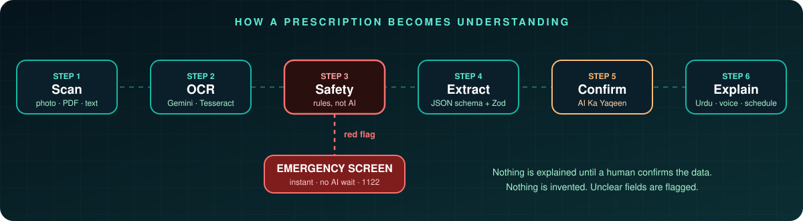

<div align="center">

<a href="https://ai-hackathon-1-mu.vercel.app/">

</a>

<h3>Urdu-first AI that reads your prescription and lab report, explains it in Urdu & Roman Urdu with voice, builds your daily medicine schedule, and overrides the AI with a safety engine when it matters.</h3>

<a href="https://ai-hackathon-1-mu.vercel.app/">

</a>

<br/>

<a href="https://ai-hackathon-1-mu.vercel.app/">

</a>

<br/><br/>


<br/><br/>

<sub>
<a href="#-the-30-second-pitch"><b>⚡ Pitch</b></a> &nbsp;·&nbsp;
<a href="#-how-it-works"><b>🧬 How it works</b></a> &nbsp;·&nbsp;
<a href="#-the-prescription"><b>℞ Features</b></a> &nbsp;·&nbsp;
<a href="#-why-this-should-win"><b>🏆 Why we win</b></a> &nbsp;·&nbsp;
<a href="#%EF%B8%8F-contraindications"><b>🛡️ Safety</b></a> &nbsp;·&nbsp;
<a href="#-3-minute-demo"><b>🎬 Demo</b></a> &nbsp;·&nbsp;
<a href="#-faq"><b>❓ FAQ</b></a>
</sub>

</div>


```text
┌────────────────────────────────────────────────────────────────────┐
│  ℞   SEHAT SAATHI CLINIC PAD                                       │
│ ────────────────────────────────────────────────────────────────── │
│  Patient  : Anyone who can't read their own prescription           │
│  Age      : 5 to 95                                                │
│  Language : اردو · Roman Urdu · English                            │
│  Date     : 17 November 2026                                       │
│                                                                    │
│  Diagnosis: Health-literacy gap  (not a medical diagnosis)         │
│                                                                    │
│  ℞  1 × Sehat Saathi                                               │
│     Sig: Take a photo. Read it. Listen to it. Follow it.           │
│     Refills: unlimited                                             │
│                                                                    │
│                                   ~ Abdullah Javid                 │
│                                   Dispensed at STCS AI Hackathon   │
└────────────────────────────────────────────────────────────────────┘
```

## ⚡ The 30-Second Pitch

> **A prescription is easy to receive and hard to understand.**
>
> In Pakistan it is often written in English, in medical shorthand, or in handwriting that even educated readers struggle with. Patients are left guessing: *which medicine is for what, how many times a day, before or after food, and is this lab value serious?*
>
> **Sehat Saathi** (*"Health Companion"*) takes a **photo of a prescription or lab report** and returns a **plain Urdu / Roman Urdu explanation, a voice readout, an automatic daily medicine schedule, and an instant emergency screen** if a red-flag symptom appears.
>
> It never diagnoses. It helps people **understand what their own doctor already told them.**

<div align="center">

| 📷 **Scan** | 🔎 **Understand** | 🗣️ **Listen** | 💊 **Follow** | 🚨 **Stay safe** |
|:---:|:---:|:---:|:---:|:---:|
| Photo, PDF or text | Structured extraction + your confirmation | Urdu voice, large text | Daily schedule + reminders | Rules override AI |

</div>


## 🩺 The Case

| The patient asks | What goes wrong |
|---|---|
| *"Yeh dawa kis cheez ki hai?"* | Wrong medicine for the wrong reason |
| *"Kitni dafa, khane se pehle ya baad?"* | Missed or doubled doses |
| *"Yeh lab value theek hai?"* | Needless panic, or ignored warning signs |
| *"Kab foran hospital jaana hai?"* | Delayed emergency care |
| *"Sasta ilaaj kahan milega?"* | Dependence on informal advice |

**Low-literacy and Urdu-speaking patients cannot reliably understand prescriptions, lab reports and medical instructions.** That gap causes medication errors, missed doses, anxiety and delayed care. Sehat Saathi closes it.


## 🧬 How It Works

<div align="center">

</div>

**Four design rules that make it trustworthy**

1. **Safety is not AI.** A deterministic rule engine (`lib/safety/redFlags.ts`) decides emergencies, so model latency can never delay help.
2. **Structure over prose.** Gemini must answer in a strict JSON schema, validated by Zod. Invalid output is rejected and retried once.
3. **A human signs off.** Low-confidence or missing fields must be confirmed before anything is explained.
4. **Nothing is invented.** Extraction is bound to the uploaded document.


## ℞ The Prescription

Six "medicines". Each solves one part of the problem.

<table>
<tr>
<td width="60" align="center"><h2>℞1</h2></td>
<td>

**📷 SCAN**<br/>
Upload a JPG, PNG, WebP or PDF, or paste text. Images are resized in the browser. OCR runs on **Gemini Vision** with **Tesseract.js** as fallback.

</td>
</tr>
<tr>
<td align="center"><h2>℞2</h2></td>
<td>

**🔎 UNDERSTAND**<br/>
Medicines, strengths, doses, frequency, duration, food instructions, lab values and reference ranges are extracted into a strict schema. Lab values get a cautious label: `Normal` · `Needs Attention` · `Discuss with Doctor` · `Unknown`. Unclear fields are flagged, never guessed.

</td>
</tr>
<tr>
<td align="center"><h2>℞3</h2></td>
<td>

**✅ CONFIRM, "AI Ka Yaqeen"**<br/>
The original image sits beside the extracted fields, with amber highlights on anything unverified. The user fixes and confirms before any explanation appears.

</td>
</tr>
<tr>
<td align="center"><h2>℞4</h2></td>
<td>

**🗣️ LISTEN**<br/>
Short Urdu, Roman Urdu and English cards with **voice playback** (play, pause, replay, speed). Large text (`A+`), high contrast, keyboard navigation and big touch targets.

</td>
</tr>
<tr>
<td align="center"><h2>℞5</h2></td>
<td>

**💊 FOLLOW**<br/>
A visual daily schedule (Morning · Afternoon · Night · As Needed) with with-food indicators, dose checkboxes and browser reminders.

</td>
</tr>
<tr>
<td align="center"><h2>℞6</h2></td>
<td>

**🚨 PROTECT**<br/>
Chest pain, severe breathing difficulty, fainting, severe allergic reaction, uncontrolled bleeding, self-harm thoughts and stroke signs trigger an instant emergency screen (`1122`, `115`). Press **`Shift+E`** from any screen.

</td>
</tr>
</table>

### ➕ Special preparations

| Preparation | Route | For whom |
|---|---|---|
| 👵 **Ammi Mode** | `/ammi` | Zero-literacy users. One medicine per card, giant fonts, sunrise / sun / moon / meal pictograms, one-tap Urdu voice |
| 🌳 **Mera Khandaan** | `/family` | Families. Up to 3 generations and 8 members, an *"Aaj poore khandaan ki dawaein"* timeline, JSON export/import, print chart, Gemini WhatsApp summary |
| 🤝 **Caregiver Mode** | `/caregiver` | Caregivers. Consent-based shared summary and missed-dose alerts, one-tap local deletion |
| 🏥 **Care Finder** | `/care` | Lahore clinics, hospitals, pharmacies and telehealth by area, type, affordability and language (demo dataset) |

### 🧪 Lab tests we run on ourselves

| Test | Route | What it checks |
|---|---|---|
| **Samajh Gaye?** | `/api/teach-back` | Did the patient actually understand? |
| **Dawa Se Poochho** | `/api/ask-medicine` | Q&A about one medicine |
| **Dawa-Match Check** | `/api/medicine-match` | Does the strip in your hand match the prescription? |
| **Accuracy Scorecard** | `/eval` | Live extraction results on 5 synthetic prescriptions |
| **Judge, Aap Koshish Karein** | `/api/safety-challenge` | Try to break the emergency engine yourself |


## 🏆 Why This Should Win

| What judges look for | What Sehat Saathi shows |
|---|---|
| **🎯 Real problem** | A daily, universal pain: patients cannot read their own prescriptions |
| **💡 Innovation** | Ammi Mode, Mera Khandaan family tree, AI Ka Yaqeen verification, teach-back comprehension check |
| **🧠 Technical depth** | Gemini Vision + Tesseract fallback, JSON-schema output, Zod validation with retry, deterministic safety engine, Web Speech voice |
| **🛡️ Responsible AI** | Safety rules override the model, human confirmation, no diagnosis, no patient database, synthetic data only |
| **♿ Accessibility** | Urdu script, Roman Urdu, voice, large text, high contrast, pictograms, keyboard navigation |
| **🔬 Proof, not claims** | Live **Accuracy Scorecard** (`/eval`) and **Judge Safety Challenge** let you test it yourself |
| **💼 Business viability** | Clinics, pharmacies, telehealth, NGOs and an API, with a clear go-to-market |
| **🌍 Impact** | Direct fit for **UN SDG 3: Good Health and Well-Being** |


## 📸 Waiting Room

> 📝 *Add real screenshots or a short GIF in `docs/` before submitting. This section matters a lot.*

| Scan | Verify | Listen | Ammi Mode |
|:---:|:---:|:---:|:---:|
| `docs/scan.png` | `docs/verify.png` | `docs/listen.png` | `docs/ammi.png` |

| Schedule | Family Tree | Emergency | Care Finder |
|:---:|:---:|:---:|:---:|
| `docs/schedule.png` | `docs/family.png` | `docs/emergency.png` | `docs/care.png` |


## 📋 Sig: How to Use

```bash
git clone https://github.com/mabdullahab614-alt/Ai-duo-Sehat-Saathi-.git
cd Ai-duo-Sehat-Saathi-
npm install
cp .env.example .env.local      # set GEMINI_API_KEY=your_actual_key
npm run dev                     # → http://localhost:3000
```

Requires Node.js 20+, npm 10+ and a [Gemini API key](https://aistudio.google.com/).

<details>
<summary><b>Environment variables</b></summary>

| Variable | Required | Notes |
|---|---|---|
| `GEMINI_API_KEY` | Yes | Server-side only, never sent to the browser |
| `GEMINI_MODEL` | Optional | Override the default Gemini model |
| `NEXT_PUBLIC_FIREBASE_API_KEY` | Optional | App runs in local demo mode without Firebase |
| `NEXT_PUBLIC_FIREBASE_AUTH_DOMAIN` | Optional | |
| `NEXT_PUBLIC_FIREBASE_PROJECT_ID` | Optional | |
| `NEXT_PUBLIC_FIREBASE_STORAGE_BUCKET` | Optional | Consent-gated demo uploads |
| `NEXT_PUBLIC_FIREBASE_MESSAGING_SENDER_ID` | Optional | |
| `NEXT_PUBLIC_FIREBASE_APP_ID` | Optional | |

Never commit `.env.local` or real keys.

</details>

<details>
<summary><b>Production build check</b></summary>

```bash
npm run lint
npx tsc --noEmit
npm run build
npm run start
```

</details>

<details>
<summary><b>Project structure</b></summary>

```text
sehat-saathi/
├── app/
│   ├── page.tsx        dashboard/   upload/    review/
│   ├── explain/        ammi/        schedule/  family/
│   ├── eval/           care/        caregiver/ emergency/
│   └── api/            teach-back · ask-medicine · medicine-match
│                       family-summary · eval · safety-challenge
├── lib/
│   ├── ai/             ocr.ts · gemini.ts · prompts.ts · schemas.ts
│   ├── safety/         redFlags.ts
│   └── utils/          validate.ts
├── banner.svg · ecg.svg · pipeline.svg
├── firestore.rules
└── storage.rules
```

*Adjust to match your actual folders.*

</details>


## ⚠️ Contraindications

What Sehat Saathi will **never** do:

| ✖ Never | ✔ Instead |
|---|---|
| Diagnose a disease | Explain what the document says and suggest questions for your doctor |
| Prescribe or change a dose | Show exactly what the prescription states |
| Guess an unclear word | Flag it and ask you to confirm |
| Wait for the AI in an emergency | Show the emergency screen immediately |
| Keep your files | Process them in memory only; no server-side patient database |
| Share without consent | Caregiver sharing is opt-in; local data deletes in one tap |

Every explanation and safety screen carries this notice:

> *"Yeh medical diagnosis nahi hai; emergency ya serious symptoms mein foran qualified healthcare professional se rabta karein."*

**Demo data policy:** only synthetic or user-authorized, non-sensitive documents.

## 🧪 Ingredients

| Ingredient | Role |
|---|---|
| **Next.js App Router + TypeScript (strict)** | App framework |
| **Tailwind CSS** | Dark-first, high-readability UI |
| **Framer Motion** | Springs, scan beam, animated check/cross, reduced-motion support |
| **Google GenAI SDK** (`@google/genai`) | Vision OCR and structured extraction |
| **Zod** | Runtime validation of AI output |
| **Tesseract.js** | OCR fallback |
| **Web Speech API** | Urdu voice playback |
| **Firebase** *(optional)* | Auth, Firestore, Storage with consent-gated rules |
| **lucide-react** | Icons |


## 🎬 3-Minute Demo

<details open>
<summary><b>Walkthrough with synthetic data</b></summary>

| Time | Open | Do this |
|---|---|---|
| **0:00** | `/` | Switch language, press `⌘/Ctrl + K` for the command palette |
| **0:40** | `/upload?demo=rx-1` | Tap **"Demo Try Karein"**: OCR, red-flag check, extraction |
| **1:20** | `/review` | Compare amber fields with the original image, then confirm |
| **1:45** | `/explain` → `/ammi` | Play Urdu voice, try Teach-Back, Ask Medicine, Strip Match, then Ammi Mode |
| **2:15** | `/schedule` → `/family` | Tick a dose, enable reminders, load the sample family, print |
| **2:45** | `/emergency` | Press `Shift+E` or type "chest pain" |

Optional emulator seed: `FIRESTORE_EMULATOR_HOST=127.0.0.1:8080 node scripts/seed-demo.mjs`

</details>

## 💼 Business Model

| Customer | What they pay for |
|---|---|
| 🏥 Clinics, hospitals, pharmacies | Monthly subscription for a white-labeled Urdu / regional patient-comprehension portal |
| 💊 Pharmacies | Counseling, refill and adherence tools |
| 📞 Telehealth platforms | Qualified care-navigation referrals |
| 🤝 Employers, insurers, NGOs | Sponsored health-literacy programs |
| 🔌 Digital-health apps | Usage-based document-comprehension API |

**Go-to-market:** reach patients through the clinics and pharmacies they already visit, so nobody has to build a new habit alone.
**Scale:** the same engine extends to discharge summaries, vaccination records, maternal-health instructions and chronic-care plans.

## 🔄 Roadmap

- [ ] Punjabi, Sindhi, Pashto, Balochi and Saraiki, with neural Urdu voice
- [ ] Handwriting-specialized pharmacy verification and pharmacist review handoff
- [ ] Longitudinal chronic-care adherence trends with opt-in encrypted caregiver sync
- [ ] Offline-friendly PWA for low-connectivity clinics
- [ ] Verified clinic / pharmacy registries and HL7/FHIR lab exports
- [ ] Pilot with a partner clinic or pharmacy


## ❓ FAQ

<details>
<summary><b>What is Sehat Saathi?</b></summary>
An Urdu-first AI web app that reads a photo of a prescription or lab report and explains it in Urdu, Roman Urdu and English, with voice, a daily medicine schedule and an emergency safety layer.
</details>

<details>
<summary><b>Can it replace my doctor or pharmacist?</b></summary>
No. It is an informational tool, not a medical device, and it is not clinically validated. Always confirm medicines and doses with a pharmacist or doctor.
</details>

<details>
<summary><b>What if the handwriting is unclear?</b></summary>
Low-confidence or missing fields are highlighted and must be confirmed by you. The app never silently guesses a dose.
</details>

<details>
<summary><b>Is my data stored?</b></summary>
There is no server-side patient database. Uploads are processed in memory and not saved to disk. Local browser data can be deleted in one tap.
</details>

<details>
<summary><b>What happens in an emergency?</b></summary>
A deterministic rule engine, independent of the AI, immediately shows the emergency screen with Pakistan emergency numbers.
</details>

<details>
<summary><b>Which languages are supported?</b></summary>
Urdu script, Roman Urdu and English today. Punjabi, Sindhi, Pashto, Balochi and Saraiki are on the roadmap.
</details>

## 👨‍⚕️ Prescribed by

| Name | Role | GitHub |
|---|---|---|
| **Abdullah Javid** | `YOUR_ROLE` | [@mabdullahab614-alt](https://github.com/mabdullahab614-alt) |
| `TEAM_MEMBER_2` | `ROLE` | [@username](https://github.com/username) |
| `TEAM_MEMBER_3` | `ROLE` | [@username](https://github.com/username) |

**Event:** AI Hackathon & Startup Pitch, STCS, Minhaj University Lahore, 17 November 2026
**Niche:** AI for Accessible Healthcare & Well-Being · **UN SDG 3**

## 📜 License

**All Rights Reserved © 2026 Abdullah Javid and team.** This repository is public for portfolio and demonstration only. No part may be copied, modified, distributed or used without prior written permission. Forking or cloning grants no rights.


<div align="center">

<a href="https://ai-hackathon-1-mu.vercel.app/">

</a>

<br/>

<a href="https://github.com/mabdullahab614-alt"></a>
<a href="mailto:mabdullah.ab614@gmail.com"></a>
<a href="https://www.linkedin.com/in/abdullah-javid-b217a2384/"></a>

<br/><br/>

**⚠️ Medical disclaimer.** Sehat Saathi is informational and educational. It is not a medical device and provides no diagnosis or treatment.
**In an emergency, call 1122 or go to the nearest hospital immediately.**

<br/>

<sub>Urdu health app · Urdu prescription reader · Roman Urdu medicine explanation · prescription OCR Pakistan · lab report explainer · medication adherence · medicine reminder Urdu · voice-first accessible healthcare AI · caregiver medicine tracker · SDG 3 hackathon project</sub>

</div>
