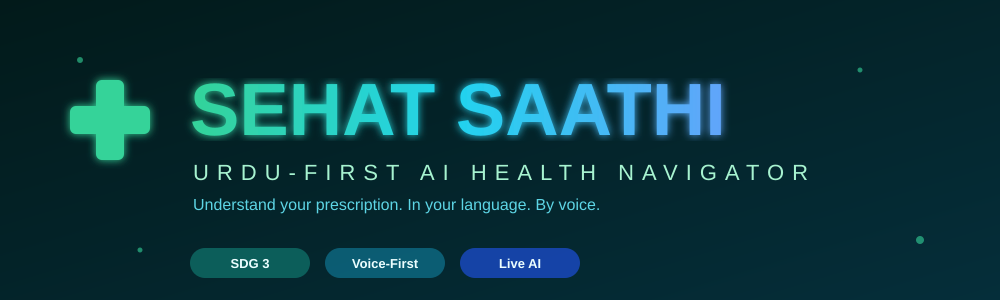

<div align="center">

<!-- Animated Banner — clickable -->
<a href="https://YOUR_LIVE_DEMO_URL">

</a>

<br/>

<!-- Animated typing subtitle -->
<a href="https://YOUR_LIVE_DEMO_URL">

</a>

<br/><br/>

<!-- Play button -->
<a href="https://YOUR_LIVE_DEMO_URL">

</a>

<br/><br/>

<!-- Badges row 1 -->

&nbsp;

&nbsp;

&nbsp;


<br/><br/>

<!-- Badges row 2 -->

&nbsp;

&nbsp;


</div>

---


## 🎯 The Problem

> **Low-literacy and Urdu-speaking patients cannot reliably understand medical instructions, prescriptions, and lab reports, leading to unsafe medication behavior, delayed care, and poor health outcomes.**

In Pakistan, a prescription is easy to receive but hard to understand. It is often written in English, in medical terms, or in difficult handwriting. Patients and caregivers are left asking:

| ❓ Question nobody answers | 😟 What happens |
|---|---|
| *"Which medicine is for what?"* | Wrong medicine at the wrong time |
| *"How much and when should I take it?"* | Missed or doubled doses |
| *"Is this lab value normal?"* | Anxiety, or ignored warning signs |
| *"What symptoms mean I need help now?"* | Delayed emergency care |
| *"Where can I go for affordable care?"* | Dependence on informal advice |

## 💡 The Solution

**Sehat Saathi** ("Health Companion") turns a photo of a prescription or lab report into something a patient can **read, hear, and act on**, in their own language.

```
 📷 Upload  ──►  🔍 OCR  ──►  🧠 LLM Understanding  ──►  🛡️ Safety Check  ──►  🗣️ Urdu + Voice  ──►  💊 Schedule
```

> ⚠️ Sehat Saathi **does not diagnose**, prescribe, or replace a doctor. It helps people *understand* what their clinician already told them.

---


<div align="center">

## 🤖 AI PIPELINE ARCHITECTURE

```
╔══════════════════════════════════════════════════════════════════╗
║                    SEHAT SAATHI AI PIPELINE                      ║
╠══════════════════════════════════════════════════════════════════╣
║                                                                  ║
║   INPUT: Prescription / Lab Report (JPG, PNG, PDF, or text)      ║
║      │                                                           ║
║      ▼                                                           ║
║   ┌─────────────────────────┐                                    ║
║   │  Image Preprocessing    │ ──► deskew, contrast, denoise      ║
║   └─────────────────────────┘                                    ║
║      │                                                           ║
║      ▼                                                           ║
║   ┌─────────────────────────┐                                    ║
║   │  OCR Extraction         │ ──► raw text + confidence          ║
║   │  (user can correct)     │     low confidence → ask user      ║
║   └─────────────────────────┘                                    ║
║      │                                                           ║
║      ▼                                                           ║
║   ┌─────────────────────────────────────────┐                    ║
║   │      LLM STRUCTURED EXTRACTION          │                    ║
║   │   • Medicines, dose, frequency, days    │                    ║
║   │   • Lab values + reference ranges       │                    ║
║   │   • Missing / ambiguous fields          │                    ║
║   │   • Questions to ask your doctor        │                    ║
║   └─────────────────────────────────────────┘                    ║
║      │                                                           ║
║      ▼                                                           ║
║   ┌─────────────────────────────────────────┐                    ║
║   │      🛡️ SAFETY RULE ENGINE              │                    ║
║   │   Rule-based layer OVERRIDES the LLM    │                    ║
║   │   chest pain · breathing · fainting ·   │                    ║
║   │   allergic reaction · bleeding ·        │                    ║
║   │   self-harm · stroke signs              │                    ║
║   │   ──► instant EMERGENCY screen          │                    ║
║   └─────────────────────────────────────────┘                    ║
║      │                                                           ║
║      ▼                                                           ║
║   ┌─────────────────────────────────────────┐                    ║
║   │   PLAIN-LANGUAGE GENERATION             │                    ║
║   │   Urdu script · Roman Urdu · English    │                    ║
║   └─────────────────────────────────────────┘                    ║
║      │                                                           ║
║      ▼                                                           ║
║   OUTPUT: 🗣️ Voice  +  💊 Schedule  +  🏥 Care Navigation        ║
║                                                                  ║
║   ⚡ Modular: OCR, LLM and Safety layers swap independently      ║
╚══════════════════════════════════════════════════════════════════╝
```

</div>

---


## ✨ Features

<table>
<tr>
<td width="50%">

### 🧠 Intelligence
- ✅ **Live OCR** on prescriptions and lab reports
- ✅ **LLM structured extraction** (medicine, dose, timing, duration)
- ✅ **Lab value explanation**: Normal / Needs attention / Discuss with doctor
- ✅ **Low-confidence detection**: asks the user to confirm unclear text
- ✅ **"Questions to ask your doctor"** checklist
- ✅ **Never invents** medicines, doses or ranges

### 🛡️ Safety
- ✅ **Rule-based red-flag engine** that overrides the LLM
- ✅ **Instant emergency screen**, never blocked by AI latency
- ✅ **No diagnosis**, ever
- ✅ **Disclaimers** on every clinical output

</td>
<td width="50%">

### 🗣️ Accessibility
- ✅ **Urdu script + Roman Urdu + English**
- ✅ **Voice playback** (play, pause, replay)
- ✅ **Large text**, high contrast, icon-driven UI
- ✅ **One action per screen** for first-time digital users
- ✅ **Adjustable font size**

### 👨‍👩‍👧 Care
- ✅ **Auto-built daily medicine schedule** (morning / afternoon / night / with food)
- ✅ **Care navigation**: clinics, pharmacies, telehealth
- ✅ **Caregiver mode**: shared summary, reminders, missed-dose flags
- ✅ **Privacy by design**: minimal data, consent, delete anytime

</td>
</tr>
</table>

---

## 👥 Who It's For

| User | Need | What they get |
|---|---|---|
| 🧑 **Patient** | Understand prescription or report | Simple explanation, voice, reminders |
| 👨‍👩‍👧 **Caregiver** | Manage medicine for a parent or child | Shared plan, alerts, easy handoff |
| 👴 **Elderly user** | Low-text, voice-first interface | Audio guidance and large UI |
| 🌾 **Rural / first-time digital user** | Simple, low-data, Urdu-first | Icon-driven UI, clear actions |
| 🏥 **Clinic / pharmacy** | Better patient understanding and adherence | White-label patient-communication tool |

---

## 🎬 User Journeys

<details open>
<summary><b>💊 Journey 1: Understand a prescription</b></summary>

1. Tap **"Prescription samajhna hai"**
2. Upload a photo (or paste text)
3. Review and confirm the extracted medicines
4. Read or **listen** to the Urdu / Roman Urdu explanation
5. Get a visual daily schedule
6. See warnings and "confirm with your pharmacist" notes

> *"Yeh antibiotic infection ke liye di gayi hai. Din mein 2 dafa, khane ke baad leni hai. 5 din tak leni hai. Agar rash ya saans ki takleef ho to foran doctor se rabta karein."*

</details>

<details>
<summary><b>🧪 Journey 2: Understand a lab report</b></summary>

1. Upload the report
2. AI identifies each test and value
3. Each value is explained and labelled **Normal / Needs attention / Discuss with doctor**
4. Get a "Questions to ask your doctor" checklist

The app never says "you have disease X."

</details>

<details>
<summary><b>🚨 Journey 3: Emergency safety check</b></summary>

1. User types a symptom such as chest pain, fainting or severe breathing difficulty
2. The **rule engine** flags it instantly
3. A full-screen emergency guidance page appears
4. The user is told to seek immediate in-person help, with no diagnosis and no delay

</details>

---

## 🛠 Tech Stack

> 📝 *Replace the items below with what your team actually used.*

<div align="center">

|  | Technology | Purpose |
|--|-----------|---------|
| ⚛️ | **Next.js + React** | Web app framework |
| 🎨 | **Tailwind CSS** | Accessible, responsive UI |
| 🔍 | **OCR** (`YOUR_OCR`, e.g. Tesseract.js / Google Vision) | Read prescription and report text |
| 🧠 | **LLM API** (`YOUR_LLM`, e.g. Claude / Gemini) | Structured extraction + Urdu / Roman Urdu generation |
| 🛡️ | **Rule-based safety engine** | Deterministic red-flag detection |
| 🔊 | **Web Speech API (TTS)** | Voice playback of explanations |
| 📍 | **Geolocation + curated facility data** | Care navigation |
| 🚀 | **Vercel** | Deployment |

</div>

---

## 🛡️ Safety, Ethics & Privacy

| Principle | How we apply it |
|---|---|
| **Not a diagnostic tool** | No diagnosis, treatment advice, prescribing or medicine substitution |
| **Safety overrides AI** | Rule engine beats LLM output for emergency symptoms |
| **No hallucinated medicine** | Structured, source-bound extraction; ambiguous fields are flagged, not guessed |
| **Human confirmation** | User reviews extracted text before explanation is generated |
| **Synthetic data only** | Demo uses synthetic or authorized non-sensitive documents |
| **Privacy by design** | Minimal data, explicit consent, delete uploads and summaries anytime |
| **Transparency** | Every clinical output states it is informational support, not clinical advice |

Aligned with WHO guidance on transparency, inclusiveness and avoiding avoidable harm in AI for health.

---

## 💰 Startup & Business Model

**Value proposition:** close the gap between *receiving* medical information and *understanding* it, improving confidence, adherence and access to appropriate care.

| Revenue stream | Customer | Model |
|---|---|---|
| 🏥 **B2B SaaS** | Clinics, hospitals, pharmacies | Monthly subscription, branded patient-communication portal |
| 📞 **Telehealth referrals** | Telehealth platforms | Pay-per-qualified-referral or revenue share |
| 💊 **Pharmacy adherence** | Pharmacies | Subscription for reminder and counselling tools |
| 🤝 **Community health** | NGOs, employers, insurers | Health-literacy and accessibility programs |
| 🔌 **API licensing** | Health apps, hospitals | Usage-based document-comprehension API |

**Go-to-market:** launch through clinics, pharmacies and community-health organizations, so patients don't need to build a new habit on their own.

**Scalability:** the same engine extends to discharge summaries, vaccination records, maternal-health instructions and chronic-disease care plans.

### 🥊 Why Sehat Saathi is different

| Existing solution | Limitation | Our advantage |
|---|---|---|
| Symptom chatbots | Diagnosis-style advice | Explains **real medical documents** |
| Translation apps | Translate words, not care | Produces schedules, warnings and next steps |
| Telemedicine apps | Need typing and digital confidence | Voice-first, low-literacy, caregiver-supported |
| Reminder apps | Manual data entry | Schedule built **automatically** from the prescription |
| Hospital portals | English-heavy, complex | Urdu-first, accessible, family-centred |

---

## ⚡ Run Locally

```bash
# 1. Clone
git clone https://github.com/YOUR_USERNAME/sehat-saathi.git
cd sehat-saathi

# 2. Install
npm install

# 3. Configure environment
cp .env.example .env.local
# → open .env.local and add your API keys (never commit this file)

# 4. Run
npm run dev
# → http://localhost:3000
```

### 🔐 Environment variables

See [`.env.example`](.env.example):

```env
LLM_API_KEY=your_llm_api_key_here
OCR_API_KEY=your_ocr_api_key_here   # only if using a cloud OCR
NEXT_PUBLIC_APP_URL=http://localhost:3000
```

> 🚫 Never commit real API keys. `.env.local` is git-ignored.

---

## 🗂 Project Structure

> 📝 *Adjust to match your actual folders.*

```
sehat-saathi/
├── app/                  # Next.js routes and screens
│   ├── page.tsx          # Home
│   ├── upload/           # Upload + review
│   ├── explain/          # Explanation + voice
│   ├── schedule/         # Medicine schedule
│   ├── emergency/        # Red-flag screen
│   ├── care/             # Care navigation
│   └── caregiver/        # Caregiver mode
├── lib/
│   ├── ocr/              # OCR layer
│   ├── llm/              # Extraction + Urdu generation
│   └── safety/           # Rule-based red-flag engine
├── banner.svg
├── .env.example
└── README.md
```

---

## 🧪 Demo Flow

1. Upload a **synthetic** prescription
2. Watch OCR extraction and confirm the fields
3. Play the **Urdu voice explanation**
4. Open the **visual medicine schedule**
5. Type *"chest pain"* → **emergency screen** triggers instantly
6. Open the **care finder**
7. Switch to **caregiver mode** and view the shared summary

---

## 🗺 Roadmap

- [ ] Regional languages (Punjabi, Sindhi, Pashto)
- [ ] WhatsApp-based reminders
- [ ] Offline-capable lightweight mode
- [ ] Drug-interaction checks against a verified database
- [ ] Clinician-validated review of explanation quality
- [ ] Pilot with a partner clinic or pharmacy

---

## 👨‍💻 Team

| Name | Role | GitHub |
|---|---|---|
| **Abdullah Javid** | `YOUR_ROLE` | [@mabdullahab614-alt](https://github.com/mabdullahab614-alt) |
| `TEAM_MEMBER_2` | `ROLE` | [@username](https://github.com/username) |
| `TEAM_MEMBER_3` | `ROLE` | [@username](https://github.com/username) |

**Hackathon:** AI Hackathon & Startup Pitch, STCS, Minhaj University Lahore (17 November 2026)
**Niche:** AI for Accessible Healthcare & Well-Being | **UN SDG 3**

---

## ⚠️ Medical Disclaimer

Sehat Saathi is an **informational and educational tool**. It is **not** a medical device, does **not** provide diagnosis or treatment, and is **not** clinically validated. Always confirm medicines and doses with a pharmacist or doctor. **In an emergency, call your local emergency number or go to the nearest hospital immediately.**

---

## 📜 License

**All Rights Reserved © 2026 Abdullah Javid and team** *(change this if your team prefers MIT or another license)*

---


<div align="center">

<a href="https://YOUR_LIVE_DEMO_URL">

</a>

<br/><br/>

<a href="https://github.com/mabdullahab614-alt"></a>
&nbsp;
<a href="mailto:mabdullah.ab614@gmail.com"></a>
&nbsp;
<a href="https://www.linkedin.com/in/abdullah-javid-b217a2384/"></a>
&nbsp;
<a href="https://YOUR_LIVE_DEMO_URL"></a>

<br/>

**⭐ Star this repo if you believe healthcare should speak your language!**

</div>
